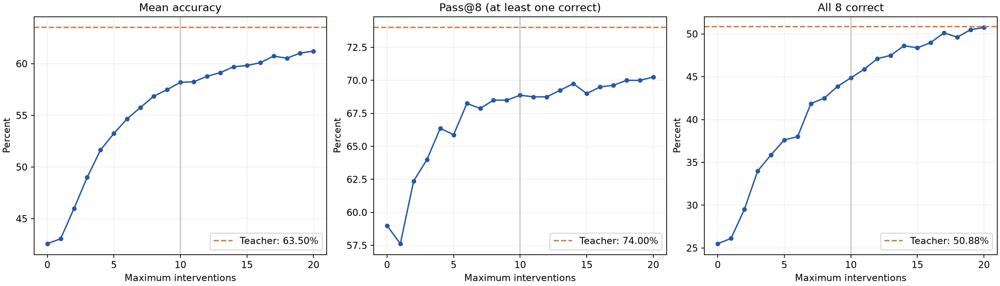

# Pass@8与八次全对率：0–20次介入

每题8次rollout中至少1次正确定义为pass@8，全部8次正确定义为pass all 8。每个数据集分母100题，总体800题；直接由逐题评分计算，不由平均acc推算。Teacher从原题生成，cap组从固定student prefix生成。

| Cap | Mean accuracy | Pass@8 | All 8 correct |
|---|---:|---:|---:|
| 0 | 42.58 | 59.00 | 25.50 |
| 1 | 43.06 | 57.62 | 26.12 |
| 2 | 45.97 | 62.38 | 29.50 |
| 3 | 49.02 | 64.00 | 34.00 |
| 4 | 51.66 | 66.38 | 35.88 |
| 5 | 53.25 | 65.88 | 37.62 |
| 6 | 54.67 | 68.25 | 38.00 |
| 7 | 55.77 | 67.88 | 41.88 |
| 8 | 56.86 | 68.50 | 42.50 |
| 9 | 57.48 | 68.50 | 43.88 |
| 10 | 58.20 | 68.88 | 44.88 |
| 11 | 58.25 | 68.75 | 45.88 |
| 12 | 58.78 | 68.75 | 47.12 |
| 13 | 59.14 | 69.25 | 47.50 |
| 14 | 59.70 | 69.75 | 48.62 |
| 15 | 59.83 | 69.00 | 48.38 |
| 16 | 60.09 | 69.50 | 49.00 |
| 17 | 60.73 | 69.62 | 50.12 |
| 18 | 60.53 | 70.00 | 49.62 |
| 19 | 61.03 | 70.00 | 50.50 |
| 20 | 61.22 | 70.25 | 50.75 |
| Teacher | 63.50 | 74.00 | 50.88 |

pass_at_8

| Dataset | 0 | 10 | 15 | 20 | Teacher |
|---|---:|---:|---:|---:|---:|
| BBH | 79.00 | 83.00 | 83.00 | 86.00 | 89.00 |
| CRUXEval-I | 34.00 | 58.00 | 57.00 | 57.00 | 68.00 |
| CRUXEval-O | 32.00 | 50.00 | 50.00 | 50.00 | 54.00 |
| HumanEval+ | 79.00 | 85.00 | 86.00 | 87.00 | 89.00 |
| LiveCodeBench | 25.00 | 30.00 | 31.00 | 33.00 | 37.00 |
| MATH500 | 92.00 | 94.00 | 92.00 | 95.00 | 94.00 |
| MBPP+ | 61.00 | 76.00 | 77.00 | 77.00 | 79.00 |
| OlympiadBench | 70.00 | 75.00 | 76.00 | 77.00 | 82.00 |

pass_all_8

| Dataset | 0 | 10 | 15 | 20 | Teacher |
|---|---:|---:|---:|---:|---:|
| BBH | 16.00 | 30.00 | 41.00 | 49.00 | 62.00 |
| CRUXEval-I | 7.00 | 38.00 | 39.00 | 39.00 | 34.00 |
| CRUXEval-O | 12.00 | 38.00 | 38.00 | 38.00 | 39.00 |
| HumanEval+ | 45.00 | 70.00 | 74.00 | 75.00 | 69.00 |
| LiveCodeBench | 9.00 | 20.00 | 24.00 | 26.00 | 26.00 |
| MATH500 | 53.00 | 64.00 | 67.00 | 68.00 | 72.00 |
| MBPP+ | 39.00 | 65.00 | 66.00 | 68.00 | 65.00 |
| OlympiadBench | 23.00 | 34.00 | 38.00 | 43.00 | 40.00 |

置信区间：10000次按数据集分层、按题目配对整簇bootstrap；保留8次rollout，以现有种子为条件，未做多重比较校正。跨预算配对不保证逐token嵌套反事实。八次全对是有限样本稳定性指标，不代表对该题永远正确。

完整统计及正确次数0–8分布：pass8_analysis.json；全21档表：pass_at_8_0_20_teacher.csv、pass_all_8_0_20_teacher.csv。
