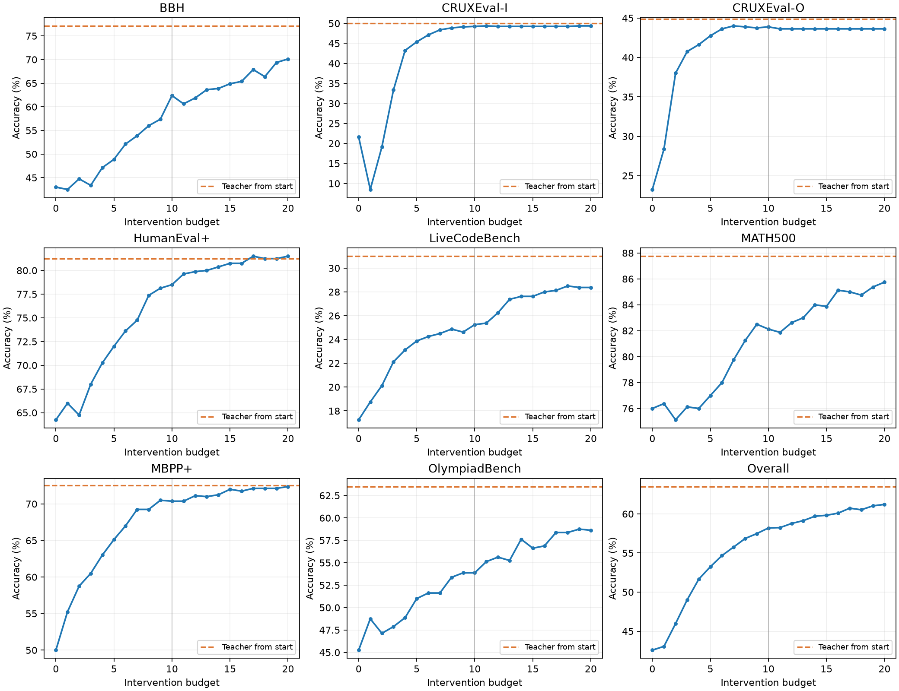

# 0–20次介入预算实验分析

134400条评分完整覆盖800题×8次×21档。新增64000条逐条核对唯一键、布尔评分、题目身份、介入次数范围，并与汇总计数一致。远程输入、种子、模型身份与原0–4档一致。未重新评分或重新哈希rollout正文。

Teacher从原始题目生成，介入组从固定student prefix生成。正确率为逐次rollout指标，非pass@8。95%区间按各数据集100题整簇重采样10000次，保留8次重复和所有预算配对；以现有种子为条件，未校正多重比较。跨预算编号配对不保证逐token嵌套轨迹。

| Dataset | 0 | 10 | 15 | 20 | Teacher | 10→20(pp) | 95% CI |
|---|---:|---:|---:|---:|---:|---:|---|
| BBH | 43.00 | 62.38 | 64.88 | 70.12 | 77.12 | 7.75 | [3.62, 11.88] |
| CRUXEval-I | 21.62 | 49.25 | 49.25 | 49.38 | 50.00 | 0.12 | [-0.25, 0.62] |
| CRUXEval-O | 23.25 | 43.88 | 43.62 | 43.62 | 44.88 | -0.25 | [-0.62, 0.00] |
| HumanEval+ | 64.25 | 78.50 | 80.75 | 81.50 | 81.25 | 3.00 | [0.88, 5.62] |
| LiveCodeBench | 17.25 | 25.25 | 27.62 | 28.38 | 31.00 | 3.12 | [1.00, 5.75] |
| MATH500 | 76.00 | 82.12 | 83.88 | 85.75 | 87.75 | 3.62 | [1.37, 6.12] |
| MBPP+ | 50.00 | 70.38 | 72.00 | 72.38 | 72.50 | 2.00 | [0.50, 4.25] |
| OlympiadBench | 45.25 | 53.87 | 56.62 | 58.63 | 63.50 | 4.75 | [1.62, 8.25] |

总体准确率（cap0至cap20）：42.58, 43.06, 45.97, 49.02, 51.66, 53.25, 54.67, 55.77, 56.86, 57.48, 58.20, 58.25, 58.78, 59.14, 59.70, 59.83, 60.09, 60.73, 60.53, 61.03, 61.22

总体差值与置信区间：
{
  "gain0_10": {
    "pp": 15.625,
    "ci": [
      13.062500000000007,
      18.171875000000007
    ]
  },
  "gain10_15": {
    "pp": 1.625,
    "ci": [
      0.8593749999999927,
      2.437500000000007
    ]
  },
  "gain15_20": {
    "pp": 1.390625,
    "ci": [
      0.90625,
      1.90625
    ]
  },
  "gain10_20": {
    "pp": 3.015625,
    "ci": [
      2.156250000000028,
      3.921874999999986
    ]
  },
  "gain0_20": {
    "pp": 18.640625,
    "ci": [
      15.952734375000007,
      21.312500000000014
    ]
  }
}

完整表：comparison.csv。实际介入次数、预算耗尽比例和分数据集统计：analysis.json。

