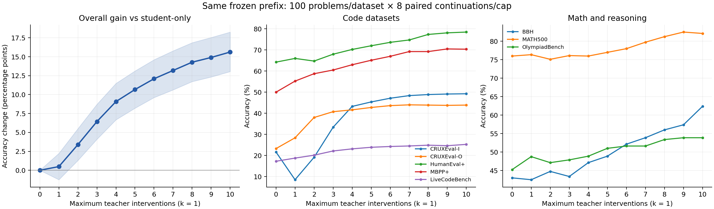

# 同一 prefix 下的 teacher 介入上限实验

范围：8 个数据集，每个 100 条固定 prefix，每个上限 8 次续写；上限0–10共70400条。阈值2，k=1。0–4与5–10两批输入字节一致，模型身份与配对种子一致，全部评分已完成。

## 准确率全表（%）

| 数据集 | 0 | 1 | 2 | 3 | 4 | 5 | 6 | 7 | 8 | 9 | 10 |
|---|---:|---:|---:|---:|---:|---:|---:|---:|---:|---:|---:|
| BBH | 43.00 | 42.50 | 44.75 | 43.38 | 47.12 | 48.88 | 52.12 | 53.87 | 56.00 | 57.38 | 62.38 |
| CRUXEval-I | 21.62 | 8.50 | 19.12 | 33.38 | 43.25 | 45.38 | 47.12 | 48.38 | 48.88 | 49.12 | 49.25 |
| CRUXEval-O | 23.25 | 28.38 | 38.00 | 40.75 | 41.62 | 42.75 | 43.62 | 44.00 | 43.88 | 43.75 | 43.88 |
| HumanEval+ | 64.25 | 66.00 | 64.75 | 68.00 | 70.25 | 72.00 | 73.62 | 74.75 | 77.38 | 78.12 | 78.50 |
| LiveCodeBench | 17.25 | 18.75 | 20.12 | 22.12 | 23.12 | 23.88 | 24.25 | 24.50 | 24.88 | 24.62 | 25.25 |
| MATH500 | 76.00 | 76.38 | 75.12 | 76.12 | 76.00 | 77.00 | 78.00 | 79.75 | 81.25 | 82.50 | 82.12 |
| MBPP+ | 50.00 | 55.25 | 58.75 | 60.50 | 63.00 | 65.12 | 67.00 | 69.25 | 69.25 | 70.50 | 70.38 |
| OlympiadBench | 45.25 | 48.75 | 47.12 | 47.88 | 48.88 | 51.00 | 51.62 | 51.62 | 53.37 | 53.87 | 53.87 |
| 总体（数据集等权） | 42.58 | 43.06 | 45.97 | 49.02 | 51.66 | 53.25 | 54.67 | 55.77 | 56.86 | 57.48 | 58.20 |

## 总体配对统计

每个上限6400次续写。准确率是逐次续写的正确率，不是pass@8。标准差为8个配对随机种子各自在800题上的准确率标准差。95%区间对每个数据集内的100条prefix整簇重采样，保留每条prefix的8次重复及全部上限配对，10000次分层bootstrap；不把同一prefix的8次结果当独立题目。区间以当前8个种子为条件，未量化新种子的不确定性；未做多重比较修正，也未覆盖GPT评分系统误差。

| 上限 | 准确率 ± 种子SD | 相对0的增益(pp) | 增益95%区间(pp) | 相对改善 | 实际平均介入次数 |
|---:|---:|---:|---:|---:|---:|
| 0 | 42.58 ± 0.87 | +0.00 | [0.00, 0.00] | 0.00% | 0.00 |
| 1 | 43.06 ± 0.74 | +0.48 | [-1.25, 2.23] | 1.14% | 1.00 |
| 2 | 45.97 ± 1.00 | +3.39 | [1.30, 5.50] | 7.96% | 1.91 |
| 3 | 49.02 ± 1.01 | +6.44 | [4.09, 8.72] | 15.12% | 2.71 |
| 4 | 51.66 ± 1.31 | +9.08 | [6.67, 11.48] | 21.32% | 3.40 |
| 5 | 53.25 ± 0.73 | +10.67 | [8.20, 13.13] | 25.06% | 3.99 |
| 6 | 54.67 ± 1.08 | +12.09 | [9.61, 14.61] | 28.40% | 4.51 |
| 7 | 55.77 ± 0.61 | +13.19 | [10.62, 15.78] | 30.97% | 4.98 |
| 8 | 56.86 ± 0.78 | +14.28 | [11.72, 16.86] | 33.54% | 5.40 |
| 9 | 57.48 ± 0.77 | +14.91 | [12.33, 17.55] | 35.01% | 5.80 |
| 10 | 58.20 ± 0.88 | +15.62 | [13.05, 18.27] | 36.70% | 6.15 |

## 关键发现

1. 总体均值随上限0–10递增：42.58%→58.20%，+15.63个百分点（相对+36.70%）；配对95%区间[13.05,18.27]个百分点。单次介入仅+0.48个百分点，区间[-1.25,2.23]，未显示稳定总体改善。
2. 按同一prefix/种子编号匹配，上限10相对0有1354次由错变对、354次由对变错，净增加1000/6400次正确。这是编号匹配的描述统计，不是固定逐token轨迹后的纯因果转移。结果不是对每条续写都改善。按每条prefix的8次平均正确率比较，800条中302条提升、79条下降、419条不变。
3. CRUXEval-I的单次介入下降最明显：21.63%→8.50%（-13.13pp，95%区间[-20.13,-6.50]）；上限3次起高于0次，10次达到49.25%。133次“0次正确、1次错误”的配对中，77次在上限10时重新正确。这是单次与多次介入表现差异的线索，但尚不能据此确定后续介入的因果修复作用或首token干预为何破坏答案。
4. MATH500在0–4次时基本持平（约75–76%），6–9次后提升，9次均值最高82.50%；10次82.13%。CRUXEval-O在约6次后均值进入43–44%平台。不能宣称每个数据集都单调提升，或10次是全局最优。
5. 上限10实际平均只介入6.15次；CRUXEval-I/O分别3.92/2.56次，LiveCodeBench为9.01次。上限与实际介入次数要分开解释；该结果不直接等价于GPU时间或端到端成本改善。

## 口径与限制

- 样本条件化于既有student轨迹中出现首次阈值>2的介入点；补抽排除了21条未观察到介入点的抽样记录。它不是整个原始数据集的无条件准确率。
- 对上限>0的分支，在冻结介入点强制先做一次teacher介入，禁止原触发student token，并计入上限；后续介入重新按阈值触发。结论仅对应此协议。
- 同种子不保证逐token轨迹严格一致：6400组prefix×replicate中，437组（6.83%）的实际介入次数随上限增加出现下降，共569处相邻下降。原因尚未定位，可能涉及并发采样/数值差异；因此不把种子配对当作严格嵌套反事实轨迹。按prefix平均的条件正确率比较仍可描述，但边际因果效应需额外控制实验。
- 0–4在单8卡节点执行；5–10在两个4卡节点执行。模型/采样/种子相同，但并发批次和数值细节可能不同；尚未用跨拓扑重复运行单独分离该因素。
- 数学与BBH使用GPT-4o-mini比较提取答案与数据集标准答案；代码采用原有测试沙箱。不存在未解决API/harness错误；2条答案提取为空判错，代码执行超时/崩溃按既有评分口径判错。
- 核验全部70400条score的唯一键、覆盖、bool标签及汇总一致性。没有在本次分析中重读并重新哈希全部原始rollout正文；评分时已记录源哈希，生成结束时已运行prefix/介入上限检查。

## 下一步建议

优先复核CRUXEval-I中0次正确、1次错误、3次及以上恢复正确的配对轨迹，并对首token强制替换/禁止原token做小规模消融，以定位单次介入下降的原因。

完整配对分数：paired_scores.csv。统计明细：analysis.json。原始评分核验：extraction_audit.json。
